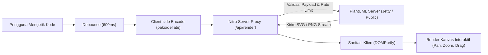

# PlantUML Studio 🎨

[](https://nuxt.com/)
[](https://vuejs.org/)
[](https://www.typescriptlang.org/)
[](https://tailwindcss.com/)
[](https://codemirror.net/)
[](https://www.docker.com/)
[](https://opensource.org/licenses/MIT)

**PlantUML Studio** adalah aplikasi web modern, cepat, dan intuitif untuk merancang, mengedit, dan memvisualisasikan diagram [PlantUML](https://plantuml.com/) secara *real-time*. Dibangun menggunakan ekosistem mutakhir **Nuxt 4 / Vue 3 (Composition API & TypeScript)**, **Tailwind CSS**, dan **CodeMirror 6**.

Dilengkapi kanvas interaktif dengan fitur *pan & zoom*, manipulasi posisi elemen diagram secara visual (*drag & drop*), kanvas kertas (*paper canvas*) yang dapat disesuaikan ukurannya, ekspor multi-format (SVG, PNG, PUML), sistem berbagi via URL hash tanpa basis data, serta manajemen proyek lokal berbasis `localStorage`.

---

## 📑 Daftar Isi

- [Fitur Utama](#-fitur-utama)
- [Arsitektur & Alur Kerja](#-arsitektur--alur-kerja)
- [Struktur Direktori Proyek](#-struktur-direktori-proyek)
- [Prasyarat Sistem](#-prasyarat-sistem)
- [Panduan Instalasi & Pengembangan](#-panduan-instalasi--pengembangan)
- [Konfigurasi Environment Variable](#-konfigurasi-environment-variable)
- [Menjalankan dengan Docker & Docker Compose](#-menjalankan-dengan-docker--docker-compose)
- [Pintasan Keyboard & Kontrol Interaktif](#-pintasan-keyboard--kontrol-interaktif)
- [Template Diagram Bawaan](#-template-diagram-bawaan)
- [Daftar Perintah (NPM Scripts)](#-daftar-perintah-npm-scripts)
- [Keamanan & Optimasi](#-keamanan--optimasi)
- [Kontribusi & Lisensi](#-kontribusi--lisensi)

---

## 🌟 Fitur Utama

### 1. ✍️ Editor Kode Berdaya Tinggi (CodeMirror 6)
- **Syntax Highlighting PlantUML**: Pewarnaan sintaks kustom untuk *keywords*, *arrows*, *skinparam*, *actors*, *classes*, dan *comments*.
- **Auto-Render dengan Debounce**: Diagram otomatis dirender 600 ms setelah Anda selesai mengetik tanpa membebani server.
- **Pintasan Keyboard**: Render instan kapan saja menggunakan **`Ctrl + Enter`** (Windows/Linux) atau **`Cmd + Enter`** (macOS).
- **Statistik Baris & Karakter**: Indikator penghitung baris dan total karakter secara *real-time* di bagian bawah editor.
- **Line Numbers & Code Folding**: Navigasi dan pelipatan blok diagram yang rapi.

### 2. 🔍 Kanvas Pratinjau Diagram Super Interaktif
- **Format Keluaran Ganda**: Beralih instan antara format vektor **SVG** (tajam tanpa pecah) dan raster **PNG**.
- **Zoom & Pan Bebas**:
  - Zoom halus menggunakan roda mouse (*scroll*) atau tombol kontrol (`+` dan `-`).
  - Indikator persentase zoom dengan tombol klik untuk reset ke `100%`.
  - Tombol **Fit to Screen** untuk otomatis menyesuaikan ukuran diagram ke layar.
  - Geser (*pan*) kanvas bebas dengan *drag* mouse kiri atau sentuhan jari di layar sentuh.
- **🖐️ Manipulasi Objek Diagram Secara Visual (*Drag & Move*)**:
  - Pindahkan posisi node, aktor, kelas, atau elemen diagram langsung di atas kanvas SVG!
  - Dilengkapi stack **Undo (`Ctrl + Z`) / Redo (`Ctrl + Y`)** visual untuk membatalkan atau mengulangi pergeseran objek.
- **📐 Resizable Paper Background (Kanvas Kertas)**:
  - Tarik sisi atas, bawah, kiri, kanan, atau sudut kanvas putih untuk menyesuaikan margin dan ruang diagram.
  - Klik ganda pada *handle* untuk mereset ukuran kertas ke ukuran bawaan.

### 3. 🗂️ Manajemen Proyek Lokal & Autosave
- **Manajemen Proyek Lengkap (CRUD)**:
  - Buat proyek baru (*New Project*).
  - Ganti nama proyek (*Rename*).
  - Duplikasi proyek (*Duplicate*).
  - Hapus proyek (*Delete* dengan dialog konfirmasi aman).
- **Penyimpanan Lokal (localStorage)**: Seluruh diagram tersimpan di peramban Anda tanpa perlu registrasi akun atau server database luar.
- **Autosave Real-Time**: Setiap ketukan dan perubahan kode langsung tersimpan otomatis ke draft proyek yang aktif.

### 4. 🚀 Ekspor, Unduh, dan Berbagi Instan
- **Modal Ekspor Khusus**:
  - **SVG (.svg)**: Gambar vektor resolusi tak terbatas, sangat cocok untuk web, dokumen teknis, dan aplikasi desain (Figma/Illustrator).
  - **PNG (.png)**: Format raster siap pakai untuk slide presentasi dan laporan.
  - **PlantUML Source (.puml)**: Berkas sumber mentah untuk diintegrasikan ke repositori atau IDE lain.
- **Modal Berbagi (Share)**:
  - **Tautan Berbagi Online (Hash URL)**: Menghasilkan link dengan kode diagram terkompresi pada URL hash (`#code=...`). Penerima tautan dapat langsung membuka diagram tanpa memerlukan penyimpanan database di backend.
  - **Direct Image Link**: Tautan langsung ke server PlantUML untuk pratinjau instan di browser.
  - **Salin Kode ke Clipboard**: Salin seluruh kode ke papan klip dengan satu klik.

### 5. 📚 Galeri Template Siap Pakai
Tersedia modal katalog template diagram lengkap yang dapat dimuat dengan sekali klik:
- **Sequence Diagram**: Alur autentikasi token JWT dan siklus login.
- **Class Diagram**: Struktur domain e-commerce berbasis OOP (Inheritance, Aggregation, Association).
- **Use Case Diagram**: Sistem manajemen perpustakaan digital.
- **Activity Diagram**: Alur logika checkout transaksi dan verifikasi pembayaran.
- **Entity Relationship Diagram (ERD)**: Skema basis data e-commerce dengan notasi *Crow's Foot*.
- **Logical Record Structure (LRS)**: Pemodelan relasi tabel akademik (1:N, M:N).

### 6. 📱 UI/UX Modern & Desain Responsif
- **Resizable Split Pane**: Pembatas antara editor dan kanvas diagram pada desktop dapat digeser secara dinamis (klik ganda pembatas untuk reset ke ukuran awal).
- **Mode Mobile Adaptif**: Pada layar ponsel dan tablet, antarmuka otomatis berubah menjadi sistem tab bawah (*Editor* | *Preview*) yang nyaman digunakan dengan satu tangan.
- **Dark Mode & Light Mode**: Dukungan tema gelap/terang menyeluruh dengan sinkronisasi ke tema editor CodeMirror One Dark.

---

## 🏗️ Arsitektur & Alur Kerja

Aplikasi mengadopsi pola *client-server separation* yang bersih dan aman:



1. **Client**: Input pengguna di-debounce selama 600 ms untuk mencegah *request thrashing*.
2. **Proxy Nitro (`/api/render`)**: Melakukan validasi tipe, membatasi ukuran payload (maksimal 50 KB), menerapkan in-memory *sliding window rate limiter* (60 req/menit per IP), lalu meneruskannya ke server PlantUML.
3. **DOMPurify Sanitization**: Hasil respon SVG dari server diverifikasi dan disanitasi menggunakan DOMPurify di browser sebelum diinjeksi ke DOM, memastikan perlindungan penuh terhadap celah keamanan XSS.

---

## 📁 Struktur Direktori Proyek

```plaintext
plantuml/
├── assets/
│   └── css/
│       └── tailwind.css            # Direktif Tailwind CSS & scrollbar kustom
├── components/
│   ├── CodeEditor.vue              # Editor CodeMirror 6 dengan highlight & shortcut
│   ├── DiagramPreview.vue          # Kanvas interaktif (Pan, Zoom, SVG Drag, Paper Resize)
│   ├── ExportModal.vue             # Modal dialog untuk ekspor SVG, PNG, dan PUML
│   ├── ProjectSidebar.vue          # Laci navigasi manajemen proyek (localStorage)
│   ├── ShareModal.vue              # Modal berbagi tautan terkompresi & URL server
│   ├── TemplateModal.vue           # Modal visual pilihan template diagram
│   ├── TemplateSelect.vue          # Komponen dropdown pemilih template
│   └── Toolbar.vue                 # Bilah navigasi atas (unduh, bagi, tema, sidebar)
├── composables/
│   ├── usePlantUml.ts              # Logika encode, render API, debounce, ekspor berkas
│   ├── useProjects.ts              # Manajemen proyek CRUD & autosave di localStorage
│   └── useTheme.ts                 # State manager tema Dark / Light mode
├── pages/
│   └── index.vue                   # Halaman utama dengan layout split-pane & mobile tabs
├── public/
│   ├── favicon.ico                 # Favicon web
│   ├── logo-plantuml.png           # Aset logo PlantUML Studio
│   └── robots.txt                  # Aturan perayapan mesin pencari
├── server/
│   └── api/
│       └── render.post.ts          # Endpoint server proxy Nitro (rate limit, sanitasi, proxy)
├── utils/
│   └── templates.ts                # Data katalog 6 template contoh diagram PlantUML
├── app.vue                         # Root layout wrapper aplikasi Nuxt
├── docker-compose.yml              # Orkestrasi container Nuxt + PlantUML Server lokal
├── Dockerfile                      # Multi-stage Docker build untuk lingkungan produksi
├── nuxt.config.ts                  # Konfigurasi Nuxt, Tailwind, dan runtime config
├── package.json                    # Manifest dependensi & skrip NPM
├── tailwind.config.js              # Konfigurasi tema warna Tailwind CSS
├── tsconfig.json                   # Konfigurasi TypeScript
├── .dockerignore                   # Berkas yang diabaikan pada Docker build
├── .env.example                    # Template variabel lingkungan
├── .gitignore                      # Berkas dan direktori yang diabaikan oleh Git
└── README.md                       # Dokumentasi utama proyek
```

---

## 💻 Prasyarat Sistem

Sebelum memulai, pastikan perangkat Anda telah terpasang:
- **Node.js**: Versi `20.x` atau `22.x` (sangat direkomendasikan versi LTS)
- **NPM**, **PNPM**, atau **Yarn**
- **Docker & Docker Compose** *(Opsional, diperlukan jika ingin menjalankan server PlantUML lokal / offline)*

---

## 🚀 Panduan Instalasi & Pengembangan

### 1. Kloning Repositori
```bash
git clone <url-repositori-anda>
cd plantuml
```

### 2. Pasang Dependensi
```bash
npm install
```

### 3. Siapkan Variabel Lingkungan
Salin berkas template lingkungan `.env.example` menjadi `.env`:
```bash
# Untuk Linux / macOS
cp .env.example .env

# Untuk Windows (PowerShell)
Copy-Item .env.example .env
```

Sesuaikan isi `.env` jika diperlukan:
```env
PLANTUML_SERVER_URL=https://www.plantuml.com/plantuml
PORT=3000
HOST=0.0.0.0
```

### 4. Jalankan Server Pengembangan (Dev Mode)
```bash
npm run dev
```
Buka peramban di [http://localhost:3000](http://localhost:3000). Aplikasi akan otomatis melakukan *hot-module replacement* (HMR) saat Anda mengubah kode.

### 5. Build untuk Produksi
```bash
# Kompilasi aplikasi untuk lingkungan produksi
npm run build

# Uji hasil kompilasi produksi secara lokal
npm run preview
```
Atau jalankan server Nitro secara langsung dari berkas keluaran:
```bash
node .output/server/index.mjs
```

---

## ⚙️ Konfigurasi Environment Variable

Berikut daftar variabel lingkungan yang didukung:

| Variabel | Tipe | Nilai Default | Deskripsi |
| :--- | :--- | :--- | :--- |
| `PLANTUML_SERVER_URL` | String | `https://www.plantuml.com/plantuml` | Alamat basis server PlantUML. Dapat diarahkan ke server lokal jika menggunakan Docker. |
| `PORT` | Number | `3000` | Port tempat aplikasi web Nuxt mendengarkan permintaan. |
| `HOST` | String | `0.0.0.0` | Alamat host antarmuka jaringan yang diikat oleh server. |

---

## 🐳 Menjalankan dengan Docker & Docker Compose

Proyek ini telah dikonfigurasi penuh dengan berkas `docker-compose.yml` multi-layanan:
1. **`plantuml-server`**: Server PlantUML resmi berbasis Jetty (`plantuml/plantuml-server:jetty`) yang berjalan offline di port `8080`.
2. **`plantuml-studio`**: Aplikasi web PlantUML Studio (Nuxt) di port `3000`, yang secara otomatis terhubung ke `plantuml-server`.

### Menjalankan Seluruh Layanan (Self-Hosted / Offline):
```bash
docker compose up -d --build
```

Setelah container berjalan:
- **Aplikasi Web**: Akses di [http://localhost:3000](http://localhost:3000)
- **Backend PlantUML**: Akses di [http://localhost:8080](http://localhost:8080)

### Melihat Log Container:
```bash
docker compose logs -f
```

### Menghentikan Layanan:
```bash
docker compose down
```

---

## ⌨️ Pintasan Keyboard & Kontrol Interaktif

### Pintasan Keyboard
| Pintasan | Lingkup | Fungsi |
| :--- | :--- | :--- |
| `Ctrl + Enter` / `Cmd + Enter` | Editor | Merender ulang diagram secara manual |
| `Ctrl + Z` / `Cmd + Z` | Editor / Preview | Membatalkan perubahan teks / pergeseran objek SVG |
| `Ctrl + Y` / `Cmd + Shift + Z` | Editor / Preview | Mengulangi perubahan teks / pergeseran objek SVG |

### Gestur Mouse & Layar Sentuh (Kanvas)
| Aksi | Interaksi | Fungsi |
| :--- | :--- | :--- |
| **Zoom In / Out** | Roda Mouse (*Scroll*) / Tombol `+` `-` | Memperbesar atau memperkecil kanvas |
| **Pan / Geser Kanvas** | Klik Kiri Tahan & Geser Kanvas | Menggeser posisi sudut pandang diagram |
| **Pindahkan Objek SVG** | Klik Kiri Tahan & Geser Elemen Diagram | Mengubah tata letak node/komponen secara bebas |
| **Resize Kertas Diagram** | Tarik garis sisi atas, bawah, kiri, kanan, atau sudut | Menyesuaikan batas kanvas kertas putih |
| **Reset Ukuran Kertas** | Klik ganda pada *handle* sisi kertas | Mengembalikan ukuran kertas ke dimensi konten asli |
| **Reset Zoom** | Klik pada tombol persentase zoom | Mengembalikan zoom ke `100%` |
| **Sesuaikan ke Layar** | Klik ikon *Fit to Screen* | Menyesuaikan skala diagram agar pas di layar |
| **Ubah Lebar Panel** | Geser garis pembatas (*splitter*) tengah | Mengatur rasio lebar Editor vs Preview |
| **Reset Lebar Panel** | Klik ganda pada garis pembatas tengah | Mereset lebar split pane ke 25% editor |

---

## 📋 Template Diagram Bawaan

Aplikasi dilengkapi dengan 6 contoh template diagram yang siap digunakan sebagai titik awal:

1. **Sequence Diagram** (`sequence`):
   - Alur autentikasi token JWT antara Pengguna, Frontend (SPA), API Gateway, Layanan Otentikasi, dan PostgreSQL.
2. **Class Diagram** (`class`):
   - Arsitektur berorientasi objek sistem e-commerce yang mencakup kelas `User`, `Customer`, `Order`, `OrderItem`, `Product`, dan strategi pembayaran `PaymentMethod`.
3. **Use Case Diagram** (`usecase`):
   - Pemetaan peran aktor `Anggota`, `Pustakawan`, dan `Admin` pada sistem perpustakaan modern dengan relasi `<<include>>` dan `<<extend>>`.
4. **Activity Diagram** (`activity`):
   - Alur proses *checkout*, validasi keranjang belanja, pemilihan metode pembayaran, serta percabangan sukses/gagal.
5. **Entity Relationship Diagram** (`er`):
   - Skema relasi entitas basis data toko online dengan notasi *Crow's Foot* (`||--o{`, `}|--||`).
6. **Logical Record Structure** (`lrs`):
   - Pemodelan tabel akademik relasional (`MAHASISWA`, `DOSEN`, `MATAKULIAH`, `KRS`, `NILAI`) dengan identifikasi *Primary Key* dan *Foreign Key*.

---

## 📦 Daftar Perintah (NPM Scripts)

| Perintah | Deskripsi |
| :--- | :--- |
| `npm run dev` | Menjalankan server pengembangan Nuxt di port 3000 dengan Hot Module Replacement (HMR). |
| `npm run build` | Mengompilasi dan mengoptimasi aplikasi untuk produksi ke folder `.output`. |
| `npm run preview` | Menjalankan pratinjau hasil build produksi secara lokal. |
| `npm run generate` | Melakukan prerender statis untuk rute-rute aplikasi jika diperlukan. |
| `npm run postinstall` | Menjalankan `nuxt prepare` untuk membuat konfigurasi TypeScript dan auto-import Nuxt. |

---

## 🛡️ Keamanan & Optimasi

- **Client-Side SVG Sanitization (DOMPurify)**: Seluruh respon SVG dibersihkan dengan whitelist profil tag dan atribut ketat sebelum dimuat ke dalam browser, mencegah serangan *Cross-Site Scripting* (XSS) melalui skrip berbahaya di dalam SVG.
- **Payload Size Limiting**: Endpoint server Nitro membatasi muatan kode PlantUML maksimal **50 KB** per permintaan untuk mencegah *buffer overflow* atau serangan DoS memori.
- **Sliding-Window Rate Limiting**: Mekanisme pembatasan laju permintaan in-memory berbasis IP klien (maksimal **60 permintaan per menit**) dengan pembersihan berkala (*garbage collection*) untuk mencegah pembebanan server secara berlebih.
- **Client-Side Compression**: Berbagi diagram memanfaatkan algoritma kompresi Deflate bawaan PlantUML pada *URL hash*, sehingga kode tidak disimpan maupun terekspos di log server perantara.

---

## 📄 Lisensi & Kredit

Proyek ini dirilis di bawah lisensi [MIT License](LICENSE).

### Teknologi yang Digunakan:
- [Nuxt](https://nuxt.com/) - Framework Vue full-stack yang modern dan intuitif.
- [Vue.js](https://vuejs.org/) - Framework JavaScript progresif.
- [Tailwind CSS](https://tailwindcss.com/) - Framework CSS utility-first untuk desain cepat dan fleksibel.
- [CodeMirror](https://codemirror.net/) - Editor kode berbasis browser yang kaya fitur.
- [DOMPurify](https://github.com/cure53/DOMPurify) - Pustaka sanitasi XSS untuk HTML dan SVG.
- [PlantUML](https://plantuml.com/) - Generator diagram dari teks berbasis komponen terbuka.
